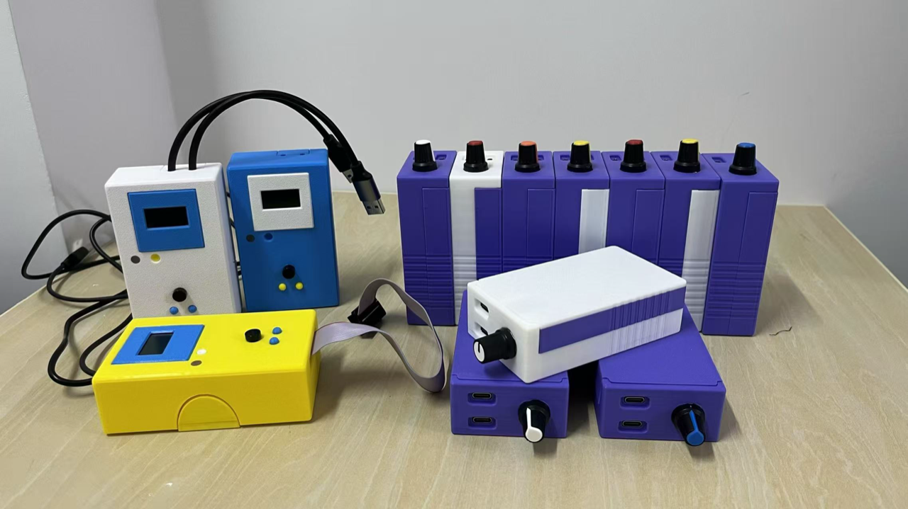
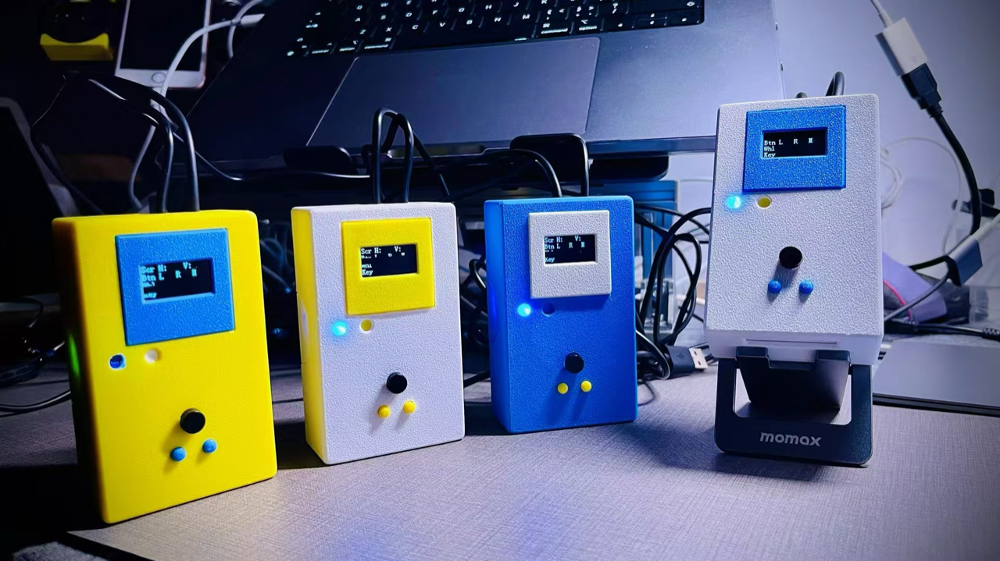

# Quileg STM32（第一代 / 第二代）

> 一台会让电脑自己动手的小设备：**以标准 USB 键盘 + 鼠标的身份**，把编排好的操作真实地按出来。本项目是它的**前两代固件源码与上位机工具**，2024–2025 年的最终版本，现已归档。

**English**: Quileg generations 1 (2024) and 2 (2025) — an STM32F103 based USB HID keyboard/mouse emulator driven over a 9600-bps serial line with 10-byte command packets. Firmware (final versions), the browser-based flow editor, the serial protocol spec, and documentation. Archived; the current project is [Quileg HID](https://jianghui1974.github.io/Quileg-HID/) (ESP32-S3, Bluetooth).

| 多种外壳版本（左：白/蓝/黄；右：紫色多机组合） | 通电使用中，OLED 显示运行状态 |
|---|---|
|  |  |

> 实拍来自作者的作品页 <https://www.godar.cn/products/quileg/>。第二张的 OLED 显示的正是 `OLED_InitDisplay()` 里写死的那几行标签（`S H:` / `V:` / `B L R M` / `W` / `K`），可作为代码与实际产品对得上的一份旁证。

---

## 这是什么

把设备插到电脑上，它会以**一块标准键盘加一只鼠标**的身份出现（不需要驱动）。上位机（一个本地网页）把一串操作编码成 **12 字节的串口指令帧**，设备收到后转成 USB HID 报告发出去——于是"打开页面 → 点击 → 滚动 → 复制 → 粘贴 → 保存"这类重复劳动，就变成一条可以重放、可编辑、可导出的流程。

**它的边界很清楚**：只是代替手指去按键、点鼠标。不注入进程、不修改软件、不绕过任何逻辑，目标机上也**不需要安装任何客户端**。

## 三代演进

| 代 | 时间 | 形态 | 状态 |
|---|---|---|---|
| **第一代** | 2024-07 | STM32F103 + OLED 屏 + 按键，有线 USB 键鼠，做过黄/白/蓝三种外壳 | **本仓库**（最终版 `202407310055`） |
| **第二代** | 2025-07 | 仍是 STM32F103；去掉屏幕，**新增蜂鸣器与 PA0 板上开关**，加了上电自检；外壳**内置 USB HUB**（三档旋钮切换连接方式：硬件已做、软件未开发），支持多机并排/堆叠 | **本仓库**（最终版 `202507251525`） |
| 第三代 | 2026– | [Quileg HID](https://jianghui1974.github.io/Quileg-HID/)：ESP32-S3 + 蓝牙，目标从电脑换成手机，让 AI 直接操作 iPhone | 当前项目，**另有仓库** |

同一个内核：**让设备以标准键盘和鼠标的身份工作**。前两代做的是插在电脑上的有线设备；第三代改走蓝牙，把目标换成了手机。

## ⚠️ 上手前必读：第二代固件带"上电自检"

第二代最终版固件在**每次上电时**会执行一段演示代码：蜂鸣器响两声 → 鼠标画一圈方框 → **按一次 `⌘+Shift+3`（macOS 截屏）** 和一次安卓截屏组合键 → 再响三声。

也就是说：**把它插到 Mac 上并上电，它会自己截一张图、动一下鼠标。** 这不是故障，是当年调试留下的自检。

- 如果你只想学习或复刻硬件：无所谓，知道这回事即可。
- 如果你要把它当日常设备用：**归档版不提供补丁**（保持当年最终源码原样）。请自行打开 `Core/Src/main.c`，把那几条演示调用（从 `processMouseCommand(mouse_keyboard_test_2)` 到 `processKeyboardCommand(mouse_keyboard_test_6)`）注释掉或用 `#if 0` 包住，再重新编译。第一代固件没有这个问题。

## 仓库内容

```
Quileg-STM32/
├── firmware/
│   ├── gen1-2024/          第一代最终版 CubeIDE 工程（含 Core/ Drivers/ Middlewares/ USB_DEVICE/）
│   ├── gen2-2025/          第二代最终版 CubeIDE 工程
│   └── reference/
│       └── usbd_hid-override/   ⚠️ 复合 HID 描述符的"手工替换版"文件（见下）
├── tools/
│   └── web-assistant/      上位机：单文件网页（Web Serial API），流程编辑 + 一键执行
├── examples/               两个最小的流程示例（.quileg）
├── site/                   项目主页（静态站，可直接部署到 GitHub Pages；见 site/README.md）
└── docs/
    ├── protocol.md         串口协议：帧结构、字段、全部命令范例
    ├── hardware.md         引脚与外围、USB 描述符、硬件版本差异
    ├── architecture.md     固件结构与运行时行为（含已知限制）
    ├── build-and-flash.md  编译、烧录、以及必须手工替换 usbd_hid 的坑
    ├── history.md          迭代史（32 个工程版本）与两代差异
    ├── faq.md              常见问题
    ├── development-notes.md 开发备忘：引脚脚号与按键丝印、早期原型、救砖、项目副本流程
    └── legal-and-safety.md 使用边界与免责
```

## 快速开始

**你要准备**：一块 STM32F103C8T6 最小系统板（或原设备）、ST-Link（或兼容下载器）、USB 线、一台电脑。

1. **编译烧录**（约 5 分钟）
   用 STM32CubeIDE 打开 `firmware/gen2-2025/`，Build，再用 ST-Link 烧录。
   ⚠️ 若你从 `.ioc` 重新生成过工程，**必须**按 [build-and-flash.md](docs/build-and-flash.md) 用 `firmware/reference/usbd_hid-override/` 里的文件替换生成的 `usbd_hid.c/.h`，否则键盘和鼠标不会同时出现。
2. **接上串口**
   用 USB-TTL 把电脑接到设备的 `PA9`(TX)/`PA10`(RX)/`GND`，波特率 **9600**。
3. **打开上位机**
   用桌面版 **Chrome / Edge** 打开 `tools/web-assistant/quileg-assistant.html` → 点「连接」选择串口 → 导入 `examples/` 里的流程 → 点执行。

> 串口参数：**9600 8N1**，帧格式 `FF` + 10 字节 + `FE`。设备每执行完一帧会把同一帧**回显**回来，可当作 ACK。详见 [docs/protocol.md](docs/protocol.md)。

## 硬件要点

| 项 | 值 |
|---|---|
| 主控板 | **Nano STM32 V1.1**（慧勤智远，60×50mm，非自绘 PCB）；两个 USB-C：J1 原生 USB、J2 CH340X 串口 |
| MCU | STM32F103C8Tx（64 KB Flash / 20 KB RAM），HSE 8 MHz ×9 = 72 MHz |
| USB | PA11(DM) / PA12(DP)，HID 复合设备：键盘 Report ID **1**、鼠标 Report ID **2** |
| 串口 | USART1：PA9 TX / PA10 RX，**9600 8N1** |
| OLED（仅第一代） | **0.96" 128×64 `ZJY096I0400WG01`（中景园）**；PB13 SCL / PB15 SDA，软件 I²C |
| 蜂鸣器（第二代新增） | PA4，高电平响 |
| LED | PA8 |
| 按键 | PA0（下拉，高有效）、PB5/PB6/PB7/PB10/PB11/PB12/PB14（上拉，低有效） |

完整引脚表、按键码与 USB 描述符见 [docs/hardware.md](docs/hardware.md)。

## 已知限制（都是历史遗留，未修改）

- **串口收包是单缓冲**：上一帧没处理完又来一帧，会覆盖前一帧——上位机必须按节奏发送，不能连发。
- **命令会阻塞主循环**：键盘的"按住时长"用 `HAL_Delay` 实现（最长 2.55 s），期间不处理新命令。
- **第二代没有屏幕，但 OLED 代码还在**：`Core/oled/` 仍参与编译，每条鼠标/键盘命令还会做软件 I²C 写操作，白耗时间。清理很简单（取消编译 + 删调用），本项目保持原样未动。
- **坐标是相对的**：每帧位移上限 ±127，必须先"归位"到屏幕角落再相对移动；分辨率或窗口一变，流程就要重录。
- **"多机并联"靠硬件不靠固件**：多块板子装在一个外壳里，经**内置 USB HUB** 汇成一根线上到电脑（电脑看到多组独立键鼠）；固件没有主从/同步协议，每块板子各自收自己的串口命令——网页助手**选不同串口 + 开多个浏览器页面**分别控制。
- 流程是**开环**的：设备不知道自己点了什么、结果对不对；成败靠人看屏幕。

这些限制正是第三代换路（ESP32-S3 + 蓝牙 + 投屏 + AI 闭环）的原因。

## 维护状态

**已归档，不再维护。** 这是 2024–2025 年的最终版本，按"原样"公开，用于学习、复刻和留档：

- 不保证能编译通过（依赖 STM32CubeIDE 的版本、HAL 版本）。
- **不提供技术支持与维护**：不接受功能请求、不修 bug、不回答使用问题（归档发布）。
- 未包含：原理图、PCB、BOM、3D 外壳文件、生产用固件二进制、以及当年实际使用的业务流程。

## 许可与合法使用

- Quileg 自己的代码与文档：**MIT**（见 `LICENSE`）。
- ST / Arm 组件：保留原有许可（BSD-3-Clause / Apache-2.0 / SLA0044），**不被 MIT 重新授权**。详见 [THIRD_PARTY_NOTICES.md](THIRD_PARTY_NOTICES.md)。
- **请在你有权操作的电脑与账号上使用**；遵守目标平台的服务条款与所在地法律；不要用它批量采集他人内容、规避平台措施或从事欺诈。设备按"现状"提供，不附带任何担保。详见 [docs/legal-and-safety.md](docs/legal-and-safety.md)。

## 相关链接

- 当前项目（第三代）：**https://jianghui1974.github.io/Quileg-HID/**
- 作者其他作品：https://www.godar.cn
- 联系：contact@airdiode.com
