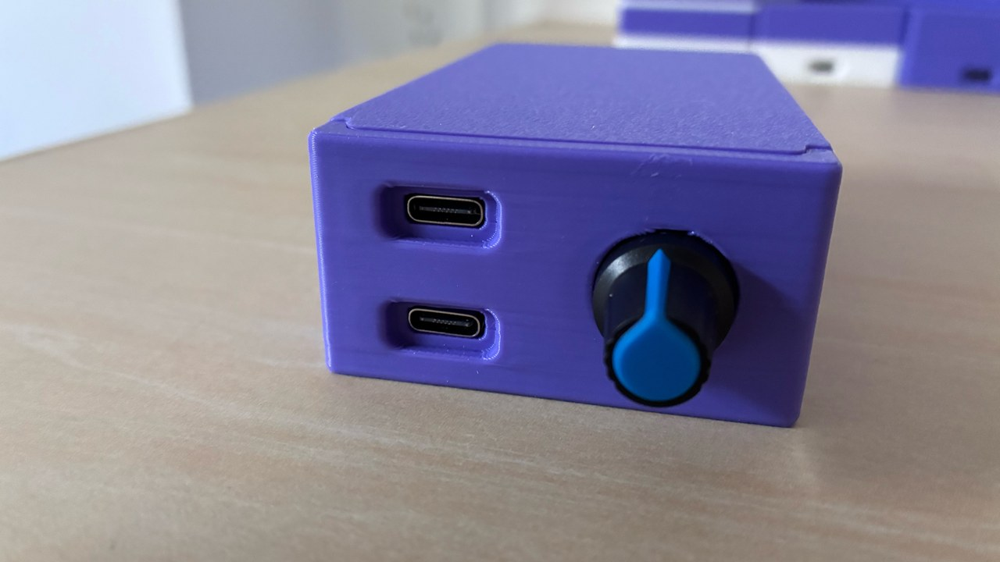
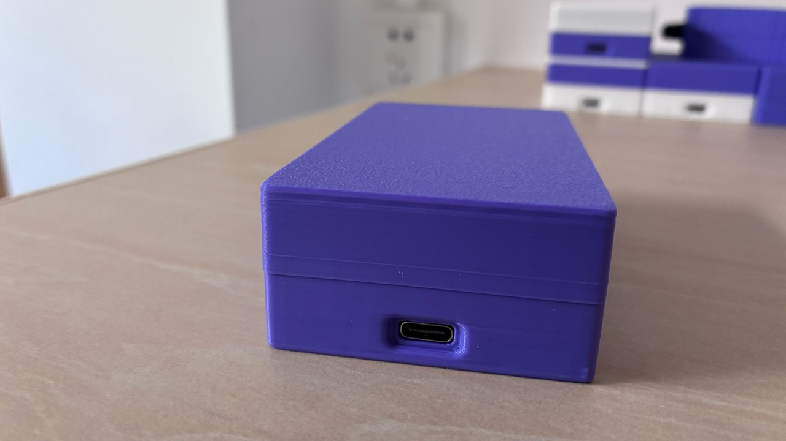

# 硬件说明

> 本仓库**不含原理图、PCB、BOM 与外壳文件**（当年没有把它们纳入版本管理）。下面全部内容由工程文件（`.ioc`）、固件源码与实际器件行为反推，**以代码为准**。复刻时请自行核对电气细节。

## 一、核心

| 项 | 值 | 依据 |
|---|---|---|
| MCU | **STM32F103C8Tx**（Cortex-M3，64 KB Flash / 20 KB RAM） | `.ioc` / 链接脚本 `STM32F103C8TX_FLASH.ld` |
| 主频 | 72 MHz（HSE 8 MHz × PLL9） | `SystemClock_Config()` |
| USB 时钟 | PLL / 1.5 = 48 MHz | `RCC_USBCLKSOURCE_PLL_DIV1_5` |
| 晶振 | 8 MHz 主晶振（PD0/PD1）；32.768 kHz（PC14/PC15，LSE 已配置） | `.ioc` |
| 调试/烧录 | SWD：PA13(SWDIO) / PA14(SWCLK) | `.ioc` |

### 主控板：Nano STM32 V1.1（慧勤智远）

**不是自绘 PCB。** 用的是**东莞市慧勤智远科技有限公司**的 **Nano STM32 V1.1** 开发板（60 × 50 × 1.6 mm）。型号来自厂商的《Nano STM32 V1.1 用户手册》与 V1.1 原理图（2024-01-17）。

**板载资源（与本项目相关的部分）**：

| 项 | 说明 |
|---|---|
| MCU | STM32F103C8T6（LQFP48，64 KB Flash / 20 KB SRAM） |
| 两个 USB-C | **J1** = STM32 原生 USB（USB SLAVE）→ 键鼠 HID；**J2** = **CH340X** USB 转串口 → 串口命令 |
| 串口 | USART1：`PA9`/`PA10` 固定接 CH340X |
| OLED 接口 | 0.96" OLED，支持 SPI 或 I²C；I²C 模式下 `PB13`=SCL、`PB15`=SDA，另有 `PB0`=OLED_RST |
| 用户 LED | **LED0（蓝色）= `PA8`** |
| 用户按键 | **WK_UP = `PA0`**、**KEY0 = `PA13`**（与 SWDIO 共用） |
| 晶振 | 8 MHz（PD0/PD1）+ 32.768 kHz（PC14/PC15） |
| 其他 | AT24C02 EEPROM、W25Q64 8 MB Flash、NRF24L01 / ESP-01S 接口、20 PIN JTAG、20 PIN LCD 接口、RT9193-33GB（5V→3.3V） |

> **厂商手册与原理图不随本仓库分发**（第三方资料）。需要时请向厂商索取，或按上面的引脚表自行接线。

**复刻建议**：买一块 **Nano STM32 V1.1**（或同规格的 STM32F103C8T6 最小系统板：LQFP48、8 MHz + 32.768 kHz 晶振、两个 USB-C / 至少一个原生 USB + 一个 CH340X），**不需要画 PCB**。OLED 接 `PB13/PB15`（I²C），7 个按键与蜂鸣器从扩展排针飞线到下表引脚。

> ⚠️ 早期原型用的**不是**这块板：而是一块 2014 年的通用 STM32F103C8T6 最小系统板（LED 在 `PC13`、OLED 在 `PB8/PB9`、串口在 `PA9/PA10`）。成品换到 Nano 板后，LED 变成板载 `PA8`、OLED 换成 `PB13/PB15`。详见 `development-notes.md`。

## 二、引脚分配

> ⚠️ **两代的引脚功能并不完全相同**：第二代在 **PA0** 加了一个板上开关、在 **PA4** 加了蜂鸣器；其余引脚两代一致。第一代有 OLED；第二代硬件去掉了屏，但 **PB13/PB15 仍被代码当作 OLED 驱动**。

| 脚号 | 引脚 | 功能 / 电平 | 第一代 | 第二代 |
|---|---|---|---|---|
| 10 | PA0 | 板上开关，**下拉**，高电平=按下 | — 未使用 | ✅ 触发 MAC 截屏测试（键码 10） |
| 14 | PA4 | 蜂鸣器，高电平响 | — 未使用 | ✅ 响 30 ms |
| 21 | PB10 | 按键 **RST**（白），上拉，低电平=按下 | ✅ 键码 10 | ✅ 键码 10 |
| 22 | PB11 | 按键 **SET**（紫），上拉 | ✅ 键码 11 | ✅ 键码 11 |
| 25 | PB12 | 按键 **DWN**（蓝），上拉 | ✅ 键码 12 | ✅ 键码 12 |
| 26 | PB13 | OLED **SCL**（软件 I²C） | ✅ 有屏 | ⚠️ 无屏，代码仍驱动 |
| 27 | PB14 | 按键 **UP**（棕），上拉 | ✅ 键码 14 | ✅ 键码 14 |
| 28 | PB15 | OLED **SDA**（软件 I²C） | ✅ 有屏 | ⚠️ 无屏，代码仍驱动 |
| 29 | PA8 | LED，输出 | ✅ | ✅ |
| 30 | PA9 | USART1 TX | ✅ | ✅ |
| 31 | PA10 | USART1 RX | ✅ | ✅ |
| 32 | PA11 | USB D− | ✅ | ✅ |
| 33 | PA12 | USB D+ | ✅ | ✅ |
| 34 | PA13 | SWDIO（ST-Link） | ✅ | ✅ |
| 37 | PA14 | SWCLK（ST-Link） | ✅ | ✅ |
| 41 | PB5 | 按键 **MID**（黄），上拉 | ✅ 键码 5 | ✅ 键码 5 |
| 42 | PB6 | 按键 **RHT**（绿），上拉 | ✅ 键码 6 | ✅ 键码 6 |
| 43 | PB7 | 按键 **LFT**（灰），上拉 | ✅ 键码 7 | ✅ 键码 7 |
| — | GND | COM（黑） | ✅ | ✅ |

**要点**：

- **按键数量**：两代都是 **7 个面板按键**（PB5/PB6/PB7/PB10/PB11/PB12/PB14）；第二代另加 **PA0 板上开关**（内部触发测试，不算面板按键），所以第二代的输入一共 8 个。
- **按键丝印颜色**来自作者的开发备忘记述（记的是带 PA0/蜂鸣器的第二代板）；第一代共用同样 7 个按键，颜色是否完全一致**没有单独记录**。
- 脚号是 **LQFP48** 封装的实际针脚号。
- `.ioc` 里 PB13/PB15 被配成 `GPIO_Output`，但实际由 `oled.c` 的软件 I²C 直接驱动。
- **早期面包板原型与成品又不同**（OLED 在 PB8/PB9、LED 在 PC13、串口曾记作 PB10/PB11），详见 [`development-notes.md`](development-notes.md)。照旧图接线会不通，请以 `.ioc` 与代码为准。

**这些引脚在 Nano STM32 V1.1 板上的"官方用途"，以及本项目怎么复用**（复刻时按右列接）：

| 引脚 | 板上官方定义（厂商手册） | 本项目用途 |
|---|---|---|
| `PA0` | **WK_UP 按键**（待机唤醒） | 第二代：板上开关，触发 MAC 截屏测试（键码 10） |
| `PA4` | NRF_CE / ESP_RST（模块接口） | 第二代：**外接蜂鸣器** |
| `PA8` | **LED0（蓝色，板载）** | 状态指示灯 |
| `PA9` / `PA10` | USART1 → **CH340X**（J2） | 串口命令 |
| `PA11` / `PA12` | USB D− / D+（J1） | USB HID 键鼠 |
| `PA13` / `PA14` | SWDIO（兼 **KEY0**）/ SWCLK | 烧录调试（KEY0 固件未使用） |
| `PB0` | OLED_RST | 未使用（软件 I²C 不控复位） |
| `PB5` / `PB6` / `PB7` | OLED_BS1 / OLED_CS / OLED_DC（I²C 模式不用） | 面板按键 MID / RHT / LFT |
| `PB10` / `PB11` | USART3（WIFI 模块接口） | 面板按键 RST / SET |
| `PB12` / `PB14` | SPI2_CS / SPI2_MISO（LCD 接口） | 面板按键 DWN / UP |
| `PB13` / `PB15` | **OLED SCL / SDA** | OLED（仅第一代有屏） |

> 也就是说：**7 个面板按键和蜂鸣器都是外接到开发板的模块排针上的**（不是板载按键）；板载的 WK_UP 被当作测试键，板载 LED0 就是状态灯。

## 三、串口接线

```
电脑 USB ──► USB-TTL 模块 ──┬── TX ──► 设备 PA10 (RX)
                            ├── RX ◄── 设备 PA9  (TX)
                            └── GND ── 设备 GND
```

- 电平 **3.3 V**（F103 的 IO 不耐 5 V）。
- 参数 **9600 8N1**，无流控。
- 设备由自己的 USB 口供电；USB-TTL 只接 TX/RX/GND 三根线即可（**不要**把 USB-TTL 的 VCC 接到设备 3.3 V 上，除非你确定没有别的供电）。

## 四、USB 描述符（这是本项目的核心技巧）

设备是一个**复合 HID**：同一接口、两个 Report ID。

| Report ID | 设备类型 | 报告长度 | 内容 |
|---|---|---|---|
| `1` | 键盘 | 9 字节（ID + 8） | 8 位修饰键 + 1 字节保留 + 6 个键码 |
| `2` | 鼠标 | 5 字节（ID + 4） | 3 位按键 + 5 位填充 + X + Y + 滚轮（相对） |

描述符里键盘那段是标准键盘布局（含 5 位 LED 输出报告）；鼠标那段把 `Wheel` 加进来，形成 3 个相对轴（`0x30 X`、`0x31 Y`、`0x38 Wheel`，逻辑范围 −127…127）。

描述符全文在 `firmware/*/Middlewares/ST/STM32_USB_Device_Library/Class/HID/Src/usbd_hid.c` 的 `HID_KEY_MOUSE_ReportDesc[]`。

**两个实现细节**：

1. **必须手工替换**：STM32CubeMX 从 `.ioc` 生成的是**单设备**（要么鼠标要么键盘）的 `usbd_hid.c/.h`。本项目在 2024-07-21 手工改成复合版，并在 `main.c` 里留了注释。**你若重新生成工程，一定要用 `firmware/reference/usbd_hid-override/` 里的两个文件覆盖**，否则只会出现一个设备。
2. 固件里鼠标报告缓冲区是 **9 字节**（历史实现），而描述符只定义 5 字节；多出的字节不参与解析。键盘缓冲区 9 字节与描述符一致。

VID/PID 仍是 CubeMX 默认的 ST 值（`0x0483` / `0x572B`，产品名 "STM32 Human interface"），当年没有改成自己的。想改就改 `USB_DEVICE/App/usbd_desc.c`——注意别冒用他人的 VID/PID。

## 五、硬件版本差异

| 项 | 第一代（2024-07） | 第二代（2025-07） |
|---|---|---|
| OLED（**0.96" 128×64，ZJY096I0400WG01 中景园**，软件 I²C） | ✅ 有，显示鼠标位移/按键/滚轮/组合键 | ❌ **硬件已去掉**，但 `Core/oled/` 代码仍在工程里并参与编译 |
| 蜂鸣器 | ❌ 无 | ✅ 新增（PA4） |
| LED | ✅ PA8 | ✅ PA8 |
| 按键 | 7 个（PB5 / PB6 / PB7 / PB10 / PB11 / PB12 / PB14） | 同样 7 个 + **PA0 板上开关**（内部测试用，共 8 个输入） |
| 上电自检 | ❌ 无 | ⚠️ **有**（响两声 → 鼠标画方框 → 按截屏快捷键） |
| 外壳 | 黄 / 白 / 蓝三种（见 `product-cases.png`） | 紫色多机外壳，**内置 USB HUB**（同图右侧） |

> 第二代保留 OLED 代码的代价：每条鼠标/键盘命令都会做一次软件 I²C 写屏，**白耗时间**（几十微秒到毫秒级，取决于实现）。想提速就把 `Core/oled/` 移出编译并删掉 `main.c` 里的 `OLED_*` 调用。本项目保持当年原样，未做清理。

## 六、关于"多机并联"

第二代支持多台设备**并排 / 堆叠运行**，靠的是**设备内置的 USB HUB**——这是硬件层的事，不是固件功能。

```
┌──────── 外壳 ────────────────────────────────┐
│  主控板 A ──┐                                │
│  主控板 B ──┼── 内置 USB HUB ──► 一根 USB 线 ──► 电脑
│  主控板 C ──┘                                │
└──────────────────────────────────────────────┘
        电脑看到的是：多组独立的 键盘 + 鼠标
```

- 每块主控板各自作为**独立的 HID 键盘/鼠标**枚举，所以电脑侧会出现**多组键鼠设备**（不是一台"多手设备"）。
- USB 全部汇到外壳内的 HUB，一根线出到电脑——省口、省线。
- **固件里没有主从、同步或总线协议**（`Serial.c` / `main.c` 逐行确认过）：每块板子只认自己串口上收到的帧，彼此不通信。

所以"并联"的分工是：**硬件负责聚合（HUB），上位机负责分配（每块板子一个串口、一个页面）**。

**上位机怎么分别控制**（作者确认的操作方式）：

1. 每块板子各有一个串口（电脑上能看到多个串口）；
2. 打开**多个浏览器页面**（或标签页），每页打开一次网页助手；
3. 每页在「连接」时**选不同的串口**，于是每页各控一块板子；
4. 各页面分别导入/执行流程，互不干扰。

复刻这个用法时注意：

- 多块板子同时往同一台电脑注入键鼠，事件会**交错**——只在"每块操作不同窗口 / 不同机器"时才有意义；
- 一条 USB 线上的多组 HID 共享带宽与枚举顺序，接太多块可能不稳定（**未实测上限**）。

> **串口侧怎么来的？** Nano STM32 V1.1 板载一颗 **CH340X**（USB-C **J2**），所以每块板子天然就是「一个 HID 设备 + 一个串口设备」；多个口经外壳内的 HUB 汇成一根线上到电脑。

### 紫色外壳：两个 USB-C + 三档旋钮





外壳两端共有 3 个 USB-C：一端是 **2 个 USB-C + 三档旋钮**（旋钮旁有蓝/黑指示），另一端 **1 个 USB-C**。

**三档旋钮用来切换内置 USB HUB 的连接方式。** 要分清两层：

- **硬件：已经做出来了**——在**已生产的机器**上就有这个旋钮，并且确实能切换 HUB 的连接方式。
- **软件：没有开发**——模式切换之后配套的应用软件（尤其"自控模式"）没有做，所以完整体验不存在。

三档的标识与含义：

- **关机**：断电。
- **被控模式**：**控制端与被控端是不同设备**——一端接控制设备（电脑），另一端接被控设备；当年标注"打开网页 `godar.cn/Web_Serial_API.html` 进行测试"。
- **自控模式**：**控制端与被控端是同一设备**；当年标注"**功能待开发**"——指的是配套软件，不是硬件。

同一页还写了"**多设备串接使用**"。

> ⚠️ **口径说明**：旋钮与 HUB 切换的**硬件已在生产机上实现**；缺的是**应用软件**。另外，每一档具体把哪个 USB-C 作为 HUB 上游、HID 与串口分别走哪一路，**没有留下电路/软件资料**。已确认能日常使用的是：内置 HUB + 每块板一个串口 + 多个浏览器页面分别控制。

## 七、没有提供的东西

- 原理图、PCB（Gerber）、BOM、外壳 3D 文件
- **厂商资料**：Nano STM32 V1.1 的用户手册与原理图属于慧勤智远，**不随本仓库分发**（需要请向厂商索取）
- 生产用固件二进制（`.bin` / `.hex`）
- OLED 模块的**厂商数据手册**（型号已知：中景园 `ZJY096I0400WG01`，0.96" 128×64；本仓库只记录型号，不附厂商资料）

如果你需要这些，只能按本仓库的引脚与代码自行设计硬件。
